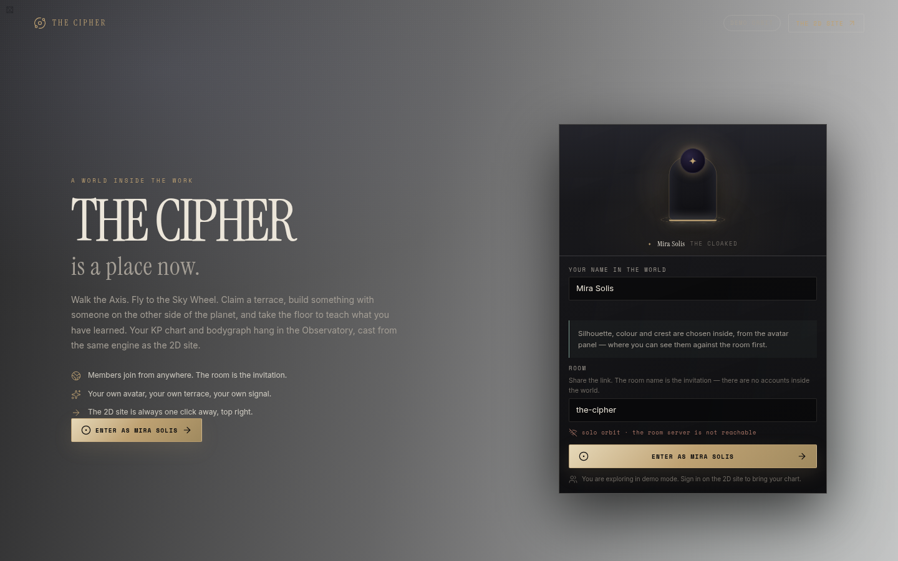
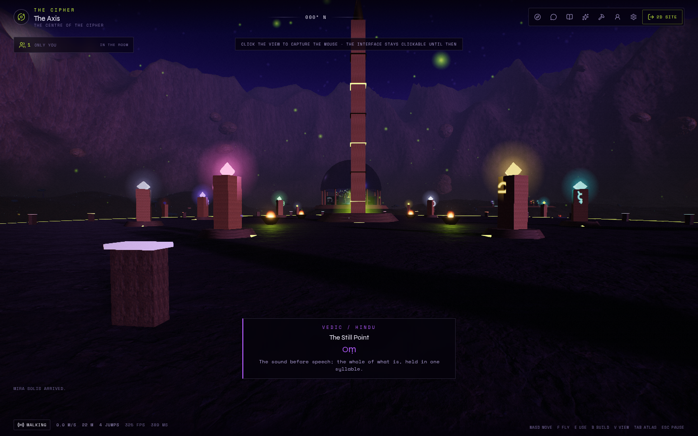
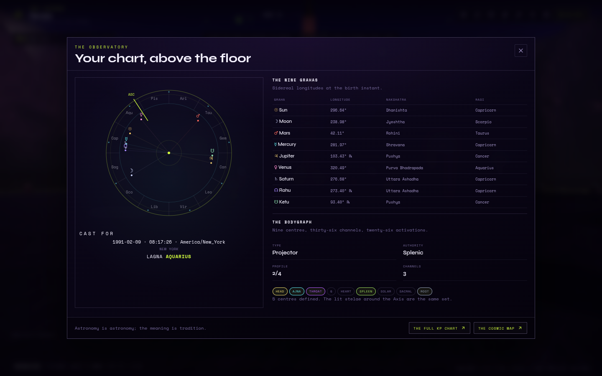
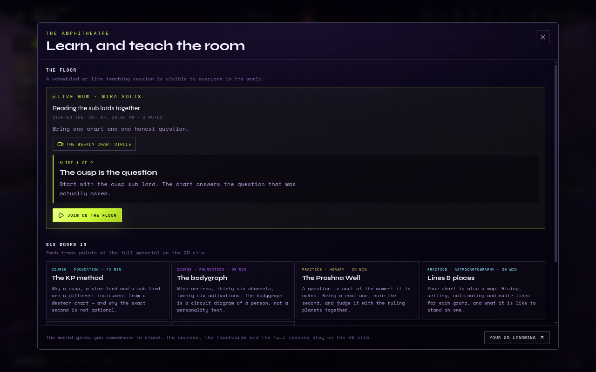
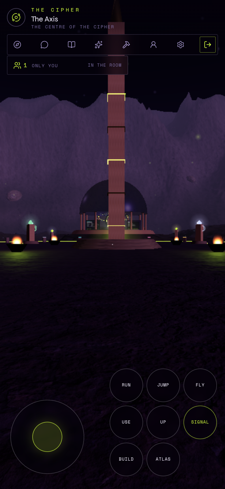
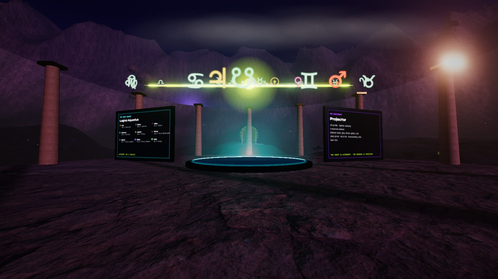

# The Cipher — the world

The Cipher's 2D site is the record: the chart, the courses, the Collective, the
billing. **The world** is the room where members meet in it. It is a full-screen,
first-person 3D valley at `/world`, built with Three.js, with the same KP and
Human Design engines behind the Observatory that the rest of the site uses.

**Live:** [cipher-zeta-indol.vercel.app/world](https://cipher-zeta-indol.vercel.app/world)
— sign-in through Clerk is required; the room runs over the HTTP/Postgres
transport on Vercel.

The 2D site is never replaced. Every member can leave the world from the HUD,
and every in-world panel links back to the page that owns the data.

| | |
|---|---|
|  |  |
|  |  |
|  |  |

---

## What is in it

| Place | What it is for |
|---|---|
| **The Axis** | The centre: a 27-mansion engraved plaza, nine graha stones, nine Human Design centre stelae, the Meridian obelisk, four braziers and the southern gate. |
| **The Observatory** | A domed hall over a still basin. The member's natal KP chart hangs as an astrolabe of light; one screen carries the graha table and lagna, the other the bodygraph. Press **E** for the full chart panel. |
| **The Amphitheatre** | Tiered stone around a speaking floor. A member can schedule or **take the floor** with a title, an opening note and up to eight slide notes; everyone sees the same session on the screen. |
| **The Studio** | The shared build bench: ten pieces, eight materials, a live ghost, and a grid that belongs to everyone. |
| **The Sanctuary** | A ring of nine graha stones, each with a resonant tone. The procedural formant choir sings the Sanskrit name as you approach. The words and meanings appear as subtitles. |
| **The Terraces** | Twelve claimable plots around a western terrace. A member names one, colours its banner, and builds inside it, up to 24 pieces. |
| **The Commons** | Eight pavilions, one for each Collective room. Walk up to a banner to open that room's persistent conversation beside you; the same messages are on `/dashboard/community/<slug>`. |
| **The Lake of Mirrors** | A real basin in the terrain, with one sounding stone on the far shore. |
| **The Sky Gate** | A ringed gate on the north rise. Use it to open the body into flight and climb toward the wheel. |
| **The Sky Wheel** | At 1,800 m: the nine grahas on the 27-nakshatra ring at their **live** sidereal longitudes, with no floor. The longitudes are computed server-side by the KP engine. |

The valley, structures, grass, trees, stones, sky and stars are procedural. The
only image assets are CC0 Poly Haven PBR surfaces (grass, rock, sand, forest,
metal, boulder, water normals) and CC BY 4.0 Solar System Scope planet maps.

The dusk grade is lit by a low sun, a cool moon fill and a textured moon disc;
the sky has a bright-star layer and a faint galactic band. In the Observatory the
astrolabe projects a soft beam into the basin, with slow ripples at its base.
The pass does not require HDR or a PMREM environment, so it remains usable on
the software and mobile GPUs that the earlier photographic sky could break.

---

## Entering, identity and controls

Open `/world` (or follow **The World** in the 2D navigation, or the card on the
dashboard). The intake screen is not a second login: it is where you choose the
name, silhouette, colour and crest the room will see. Those four choices are
saved to the member's profile in `cipher_member_avatars` (and cached in
`localStorage` for the first paint). They are appearance only — no image is
uploaded — and they follow the member across devices. The room still receives
them as presence, never as trusted state.

**Pointer capture is opt-in.** The interface is clickable until you click the
view. Once the mouse is captured, press **Esc** to release it and use the HUD
again. This is deliberate: auto-capturing the cursor makes the visible interface
unreachable.

| Desktop | |
|---|---|
| **W A S D** | walk |
| **Shift** | run |
| **Space** | jump (four times before landing) |
| **Mouse** | look (click the view to capture) |
| **F** | fly / land |
| **Space / Ctrl** (flying) | climb / descend |
| **E** | use what is in front of you |
| **B** | build mode |
| **1–9, 0** | choose a piece |
| **[ ]** | cycle material |
| **R** | rotate 15° |
| **Mouse wheel** | scale the piece |
| **LMB / RMB** | place / remove a piece |
| **Q** | send a signal |
| **V** | first / third person |
| **T** | talk |
| **J** | the Codex |
| **L** | the Learn and teaching desk |
| **C** | the chart |
| **Tab** | the Atlas |
| **P** | photo mode |
| **Esc** | close a panel, release the mouse, or pause |

On a phone or tablet the touch controls appear automatically: a joystick to move,
drag anywhere on the view to look, and buttons for run, jump, fly, up, use,
signal, build and Atlas. The HUD remains tappable.

---

## Multiplayer

The world has **two interchangeable room transports**. The realm talks to one
interface, so movement, building, terraces and sessions do not care which one is
underneath.

| Transport | When it is used | Shape | Presence | Shared events |
|---|---|---|---|---|
| **WebSocket** | A local development server, or an explicit `NEXT_PUBLIC_WORLD_WS_URL` | Standalone Node process + `ws`; JSON file | ~10 Hz | immediate |
| **HTTP + Postgres** | Vercel and other serverless hosts | Next route handler + three Neon tables; polling | ~1.2 s | on the next poll |

The client chooses automatically:

- `NEXT_PUBLIC_WORLD_WS_URL` set → WebSocket.
- `localhost` / `127.0.0.1` → WebSocket (`pnpm dev:realm`).
- Anything else → HTTP/Postgres.
- `?transport=ws` or `?transport=http` forces one, which is also how the HTTP
  transport is tested locally.

### The WebSocket room (lowest latency)

`server/world-server.mjs` is a small standalone Node process. It is the right
shape when a host allows a long-lived process: presence at 10 Hz, instant chat,
builds, terraces and sessions.

```bash
node server/world-server.mjs
# PORT, WORLD_DATA_FILE, WORLD_MAX_PLAYERS, WORLD_ROOM_SECRET
```

Host it on Railway, Render, Fly, a VPS, or beside a self-hosted Next deployment.
Set `NEXT_PUBLIC_WORLD_WS_URL=wss://world.example.com/ws` before the Next build.
Persistence is `data/world.json`, written atomically and debounced.

The room name is the only key. There are **no accounts inside the WebSocket
room**: it accepts anyone with the link and, optionally, a shared
`WORLD_ROOM_SECRET` (plus `NEXT_PUBLIC_WORLD_ROOM_KEY` for the browser). The
client presents a stable browser id (`w-…`) in the socket URL, so a plot and a
scheduled session reconnect to the same member, with a name fallback; it is not
an account and can be spoofed by anyone with the link. Treat a room as an
invitation, not a security boundary.

### The HTTP/Postgres room (works on Vercel)

Vercel cannot hold a WebSocket open. `/api/world/room` supplies the same room
over short requests, backed by the deployment's Neon database:

| Table | Holds |
|---|---|
| `cipher_world_presence` | one small row per member: position, appearance, last seen |
| `cipher_world_state` | one document per room: builds, terraces, session, signals, version |
| `cipher_world_chat` | append-only room and pavilion messages |

The member avatar is not part of the room document. It lives in the additive
`cipher_member_avatars` table, created idempotently on first use, so it follows a
signed-in member between devices. In a no-database demo it is kept in the Node
process with the seeded demo member.

The tables are created idempotently on first use and touch no existing Cipher
table. Presence is written at 2 Hz; the client polls at 1.15 s and interpolates
bodies. Builds, terrace claims, session starts and signals appear on the next
poll. Chat is append-only and fetched by id, so there are no duplicates.

In production the route is **Clerk-authenticated**: the member's world id is a
SHA-256 hash of the Clerk user id, not the account id. The same member therefore
keeps their terrace across sessions without exposing their account id to the
room. In a deployment with no Clerk keys the route admits the demo member, so a
preview is explorable.

The HTTP transport is deliberately modest: it is for co-presence, co-creation and
teaching in a contemplative world, not for a 60 Hz shooter. If you need instant
signals or 10 Hz bodies, host the WebSocket room.

### Running it locally

```bash
pnpm install
pnpm dev:realm        # Next.js + the WebSocket room (ws://localhost:8787/ws)
# or separately:
pnpm dev              # the 2D site and /world at :3000
pnpm dev:world        # the WebSocket room at :8787
```

Local development uses the WebSocket room. If it is not running, the world still
opens in **solo orbit** and says so; nothing is faked.

To exercise the HTTP transport locally, run the Next app with a `DATABASE_URL`
and add `?transport=http` to the world URL.

### Deploying

**Vercel (no extra host needed).** The HTTP room uses the project's existing
Neon integration. Add nothing except the normal `DATABASE_URL`; build and deploy
as usual. Players need a Clerk session because production is authenticated.

**WebSocket (optional, lower latency).** Deploy `server/world-server.mjs` to a
host with a long-lived process and a persistent volume, then build the Next app
with:

```bash
NEXT_PUBLIC_WORLD_WS_URL=wss://world.example.com/ws
```

`NEXT_PUBLIC_*` values are inlined at build time: set the variable before the
Next build, not only at runtime. If a reverse proxy maps `/ws` on the same origin,
the variable can be omitted from a self-hosted build.

The default room is `the-cipher`. A private evening is a room name:

```
https://your-site/world?room=our-private-room
```

### Limits

| | WebSocket | HTTP/Postgres |
|---|---|---|
| Members per room | 24 | 24 |
| Pieces per room | 1,200 | 1,200 |
| Pieces per terrace | 24 | 24 |
| Presence | ~10 Hz | ~1.2 s |
| Chat | 400 chars, 3 / 3 s | 400 chars, 3 / 3 s |
| Teaching notes | 8 slides; 120-char title, 700-char body | same |
| Build rate | 14 / 10 s | optimistic version retry |
| Persistence | `data/world.json` | Neon |
| Accounts | link + optional key | Clerk in production, demo otherwise |

### What the server validates

Neither transport trusts the client for shared state:

- piece type and material against the palette;
- world bounds, scale and rotation;
- terrace claim before a plot piece is accepted, and the 24-piece cap;
- piece removal by its owner only;
- terrace edits by the plot owner only;
- one session at a time, and only its host can close it;
- session scheduling, edits and slide changes by the host only;
- one scheduled or live session at a time;
- sanitised names, messages, session notes, call labels and room slugs; rate
  limits on chat, movement, signals, sessions and placement.

The **client** simulates its own body. The server is authoritative only about
things everybody shares. The HTTP transport adds optimistic concurrency: a
concurrent piece or terrace claim retries rather than overwriting.

---

## Terraces: a place of your own

The twelve plots are first-come in a room. A member claims one from the Plots
panel (walk to the Terraces and press **E**, or open it from the Atlas). The claim
carries a title, a motto, a beacon colour and a banner glyph; the banner and
beacon update for everyone in the room.

A terrace holds up to 24 pieces. Only the owner can edit the terrace; only the
member who placed a piece can remove it. Releasing a terrace removes its pieces
with it — the UI says so before you do it.

A plot is **not** a substitute for a profile page. It is a room with a door: a
banner, a beacon, a build, and a place to stand.

## Co-creation

The Studio is the shared bench. Anyone in the room can place there; every piece
is broadcast immediately, and the room's bench persists. The ghost shows the real
geometry at 42% opacity and turns rose where a piece cannot stand. Pieces have
real collision: you can stand on what you build.

The build grid is half a metre, rotation is 15°, and scale runs from 0.4× to 4×.
The palette is content, not code: `src/world/content/world.ts`.

## Learning and teaching

Six learning tracks in `LEARNING_TRACKS` point at the material the 2D site already
has: KP foundations, the bodygraph, Prashna, astrocartography, the Starseed
archive and the Signal Studio. The world does not re-teach them; it gives a body
somewhere to stand while it does.

The Amphitheatre adds the part the 2D site cannot: a shared teaching floor. The
host can **schedule** a session or **take the floor** now. A session carries a
title, an opening note and up to eight slide notes. Everyone in the room sees
the same scheduled card or live slide; only the host can edit the notes, advance
the slide, go live or close the floor.

A session can be attached to an **upcoming 2D call**. The 2D call stays the
calendar and the voice/video room; the world is where the notes are kept and
where the room gathers. The **Gather in the world** link on `/dashboard/calls`
opens `/world?teach=<callId>` and preselects the call in the desk. If the call's
join link is available to the member, the desk links to it; otherwise it links
back to the call on the 2D site.

The session is a signal to gather, not a streaming platform. Voice and video
stay wherever the group already meets.

### Community continuity

The pavilion tabs in the world's chat are no longer a separate, ephemeral
conversation. They read and post to the same Collective channel as the 2D site:
`/api/community/[slug]/messages` is the single transport. A message written at
the Starseed Origins pavilion appears on `/dashboard/community/starseed-origins`,
and a reply there reaches the open pavilion within a few seconds.

Unread is a notification surface rather than a second inbox:

- the Atlas has a **Recent in the Collective** section with the newest room and
  direct-thread activity;
- pavilion tabs show a **new** badge, and the HUD's Talk button carries the total;
- opening a pavilion clears its badge; opening the 2D room does the same through
  the shared read marker.

Read markers are deliberately local (`cipher:community:read:v1`), so the world
and the 2D site agree in the same browser without a migration. They are not
cross-device. Durable per-member unread counts belong in `channel_members` when
that is worth the schema work.

Direct messages keep their home on the 2D site. The Atlas shows recent threads
and unread, and links to `/dashboard/messages?thread=<id>`, which opens the right
conversation. There is no in-world DM composer yet.

## Chart data flow

`src/app/world/page.tsx` is the only place the server computes the sky:

1. Resolve the member's birth moment with `resolveKpBirth`.
2. Compute the natal sidereal positions with `siderealPositions`.
3. Compute the lagna with `kpCusps` (Placidus; a polar failure omits the lagna
   rather than inventing one).
4. Read the stored bodygraph projection for type, authority, profile, channels
   and defined centres.
5. Compute the **live** sky positions for the Sky Wheel.

Those plain numbers are passed into the client engine. The engine never invents a
longitude. The chart panel and the Observatory screens both read the same
`MemberChart` object. The meanings attached to grahas, nakshatras and centres are
tradition, labelled as tradition; the longitudes are astronomy and can be checked.

## The 2D switch

- The HUD's top-right **2D site** button leaves the world.
- Every panel footer links to the page that owns the data (chart, cosmic map,
  courses, community room).
- The 2D navigation has **The World**; the dashboard has a world card; the
  marketing site has a world section.
- The world is `noindex`; it is a room, not a landing page.

## Assets and credits

- PBR surfaces and water normals: [Poly Haven](https://polyhaven.com), CC0.
- Planet textures: [Solar System Scope](https://www.solarsystemscope.com/textures/),
  CC BY 4.0; attribution in `public/textures/planets/LICENSE.txt`.
- Renderer: [three.js](https://threejs.org), MIT.
- Noise: `simplex-noise`, ISC.
- Textiles, sky, fire, glyphs and all audio: procedural in this repository.

---

## Honest limits

- **Browser-scale realism, not a AAA game.** PBR surfaces, a low sun, haze and a
  film grade on a procedural valley. It will not look like a scanned open world.
- **Two transports, two latency profiles.** HTTP/Postgres works on Vercel with
  no extra host, but presence is ~1.2 s and signals arrive on the next poll. The
  WebSocket room is the low-latency option and needs a long-lived process.
- **The WebSocket room has no accounts.** The link is the invitation; names are
  not unique. A stable browser id lets a plot and a scheduled session reconnect,
  but it is not an account and can be spoofed. The HTTP room is Clerk-
  authenticated in production and uses an opaque member hash, but the WebSocket
  server remains link-keyed. Add token verification before opening a WebSocket
  room to strangers.
- **The world is client-authoritative about bodies.** Moving through a wall is a
  client decision; the server is authoritative about shared objects, claims and
  the session.
- **The WebSocket bench is a JSON file.** A single process is assumed. For
  multiple WebSocket instances, move persistence to Postgres/Redis. The HTTP
  transport already uses Postgres, with optimistic version retries.
- **Post-processing is optional.** `quality: low` and `?post=0` render directly.
  This keeps software WebGL and weak mobile GPUs usable at the cost of bloom,
  god rays and height fog.
- **No moderation console or reporting flow yet.** Names and messages are
  sanitised, chat is rate-limited, and the HTTP room is authenticated, but there
  is no mute/report/admin action inside the world. Add one before a large public
  room.
- **Preview and production share the project's `DATABASE_URL`.** The preview
  creates test rooms and the demo member in the same Neon database. Use a Neon
  branch (or a separate preview database) if you want preview data isolated.
- **Teaching notes live in the room, not in the 2D call record.** The call is the
  anchor and the link; the slides are room state (JSON on the WebSocket server,
  `session` on Postgres). They are not a recording, a transcript or a course
  lesson.
- **Avatar images are not uploaded.** The saved avatar is a name, silhouette,
  colour and crest. There is no photo, no file storage, and no moderation queue
  for images.
- **Read markers are per browser.** The world and the 2D site share unread in the
  same browser; a phone and a laptop do not. The read state is a convenience, not
  an account-level inbox.
- **No voice or video inside the world.** The floor is a presence signal; the
  actual call stays in the 2D site's call links or your own room.
- **Direct messages are linked, not embedded.** The world shows recent threads
  and unread and opens the right 2D conversation; it does not have an in-world DM
  composer.
- **The astrolabe and the wheel are representations.** The positions are real and
  computed; the sky does not move for drama.
- **Audio is a courtesy.** Browsers can refuse the audio context; movement never
  waits for sound.

### If something does not work

- **The HUD is not clickable** — the mouse is captured. Press **Esc**, then click.
- **Nothing moves** — click the view once to focus/capture; WASD still works
  without pointer lock.
- **The canvas is white or blank** — the browser refused or lost a WebGL context.
  Try a current browser with hardware acceleration, choose `low` quality, or use
  the flat map at `/dashboard/map`.
- **"Solo orbit"** — the room is not reachable. On Vercel check `DATABASE_URL`
  and open `/api/world/room?room=the-cipher` (signed in); locally check the
  WebSocket room on `:8787`, or add `?transport=http` and a `DATABASE_URL`.
- **The HTTP room returns 401** — production is Clerk-authenticated. Sign in on
  the 2D site first; the world shares that session.
- **A plot needs the room** — claims and shared builds are server state. In solo
  orbit they are disabled rather than faked.

---

## File map

```
src/world/
  content/world.ts        the content spine: grahas, nakshatras, centres, places,
                          pavilions, plots, build palette, avatars, learning
  engine/
    terrain.ts            one height function for ground, props, body and build
    textures.ts           PBR library and the tinted terrain shader
    sprites.ts            canvas text, glyphs, glow, fire, clouds, stars
    post.ts               depth pass, height fog, god rays, bloom, grade, SMAA
    world.ts              the valley and every built place
    space.ts              the Sky Wheel
    avatars.ts            the three member silhouettes
    build.ts              ghost, placement, collision, shared pieces
    lightning.ts          the signal
    audio.ts              procedural ambience and the formant choir
    realm.ts              body, camera, input, interaction, net, frame loop
    bus.ts                React → engine commands
  net/client.ts           transport choice, WebSocket client, reconnect and solo fallback
  net/http.ts             the HTTP/Postgres room for Vercel
  net/ids.ts              the stable browser id shared by both room transports
  net/types.ts            the transport contract the realm talks to
  state.ts                the throttled store shared by the engine and React
  ui/                     landing, HUD, panels, teaching desk, touch controls, CSS
  ui/session-time.ts      local-time formatting for the teaching desk
server/world-server.mjs   the WebSocket room and its JSON persistence
src/app/api/world/room/   the HTTP/Postgres room route (GET/POST/HEAD)
src/app/api/world/avatar/ the member avatar read/write route
src/lib/world/room.ts     shared player, validation and world transitions
src/lib/world/avatar.ts   the member avatar row and its idempotent table
src/lib/world/avatar-shared.ts  the avatar contract and sanitiser
src/lib/world/__tests__/  the session and world transition tests
src/lib/db/schema.ts      cipher_world_presence, cipher_world_state, cipher_world_chat
src/app/world/page.tsx    the server route: auth, chart, live sky, upcoming calls
src/app/dashboard/calls/  the 2D call calendar and the Gather in the world links
docs/world.md             this file
```

## Extending it

- A new place: add a `Place` in `PLACES`, a pad in `terrain.ts`, a group in
  `world.ts` and a `REGIONS` entry. The Atlas, Codex and interactions read the
  content list.
- A new build piece or material: add it to `BUILD_PIECES` / `BUILD_MATERIALS`
  **and** to the validation sets in `server/world-server.mjs`. The HTTP route
  reads the same content constants, so it follows automatically.
- A new avatar silhouette: add the form in `AVATAR_FORMS`, the geometry in
  `avatars.ts`, the 2D preview style in `world.css`, and the form to the avatar
  sanitiser in `avatar-shared.ts`. Existing saved avatars fall back to the
  cloaked silhouette if a form is removed.
- A new learning track: add a `LearningTrack`; the Learn panel and place travel
  follow it.
- A new room: add it to `COLLECTIVE_ROOMS`; the Commons pavilions are generated
  from that list.

The world is meant to be edited as content first and geometry second. Keep the
astronomy honest: pass positions in; never let a mesh decide where a planet is.
